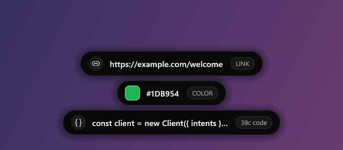
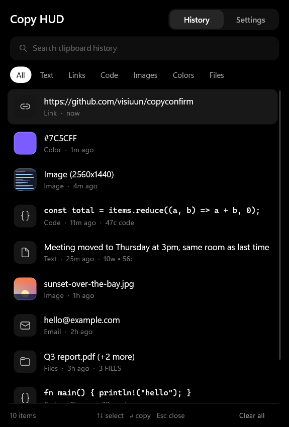
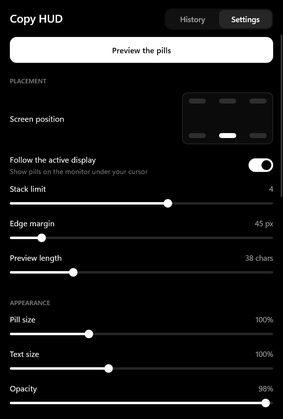

# Copy HUD

<div align="center">
  
  <br>
  <b>Finally know that you actually copied something.</b>
  <br>
  A small pill on screen every time anything hits your clipboard, plus a searchable history of all of it.
  <br><br>
  <a href="https://github.com/visiuun/copyconfirm/releases/latest">
    
  </a>
  <br><br>
  
  
  
  
</div>

<br>

<p align="center">
  
</p>

<p align="center">
  
  &nbsp;
  
</p>

## What it looks like in use

Copy something and a pill shows up for a moment, telling you exactly what landed on your clipboard.

| You copy | The pill shows |
|---|---|
| A sentence | The text, with `10w • 56c` |
| `https://example.com/page` | A link icon and `LINK` |
| `#1DB954` or `rgb(29, 185, 84)` | A live swatch in that exact color |
| A line of code | A code icon and `47c code` |
| A screenshot | A thumbnail of the image |
| An image file | A thumbnail and the file name |
| Three files in Explorer | `report.pdf (+2 more)` and `3 FILES` |
| A password from your password manager | `Copied privately`, and nothing gets saved |

Copy several things quickly and they stack. Copy 3 million characters and it's just as instant, because only the start of the text is ever read.

## Why this exists

You press Ctrl+C and nothing happens. No sound, no flash, nothing. So you press it again. And again. Then you paste it somewhere just to check, and half the time the old thing comes out anyway because the copy never registered.

It's kind of crazy that this is still how it works. Your computer will tell you the volume changed, that Caps Lock is on, that you plugged in a USB stick. Copy is one of the most used commands on any computer, and there's still no universal way to see that it happened. Win+V can show you a list if you stop what you're doing and go open it, but that isn't confirmation.

So now there is one. One glance, and you never have to spam Ctrl+C again.

## Features

**Confirmation**
- Works everywhere, in every app, with no plugins or per-app setup
- Tells text, links, emails, code, colors, images and files apart
- Spring-animated pills that stack, with real anti-aliasing and soft shadows
- Six screen positions, and they follow the monitor your cursor is on
- Nine synthesized sounds (Velvet Drop, Zen Chime, Marimba Tap and more), or mute
- Adjustable size, text size, opacity, duration and stack limit

**History**
- The last 50 things you copied, searchable and filterable by type
- Images, file lists and text all go back on the clipboard in their original form, so a restored screenshot pastes as a screenshot
- Copying something again moves it to the top instead of adding a duplicate
- Fully keyboard driven

**Privacy**
- Nothing ever leaves your PC. The app has no network code at all
- Respects the flags password managers set, so those copies are never stored
- Pause monitoring whenever you want, or keep history in memory only

**Performance**

No GUI framework, no web view, no runtime. Just Win32, Direct2D and DirectWrite. It reacts to Windows clipboard events instead of polling, and each pill is drawn once and only moved after that. Rendering stays off the GPU entirely, so it can't take frames from a game.

| | Measured |
|---|---|
| CPU while idle | 0.0 ms over 20 seconds |
| Memory in the background | about 10 MB private |
| A full three-pill animation, in and out | 16 ms of CPU in total |
| Opening the panel | about 25 ms of CPU |
| Download | one exe, under 1 MB |

## Install

1. Download `copyconfirm.exe` from the [**latest release**](https://github.com/visiuun/copyconfirm/releases/latest).
2. Run it. That's the whole install.

It needs no admin rights and no extra downloads. On first run it copies itself to `%LOCALAPPDATA%\copyconfirm`, sets itself to start with Windows, adds **Copy HUD** to the Start Menu and opens the panel. You can delete the file you downloaded afterwards.

To update, download a newer exe and run it. It closes the old version and replaces it, and your settings and history stay.

Windows SmartScreen may warn you the first time because the exe isn't code-signed. Click **More info**, then **Run anyway**. Or build it yourself, it takes about a minute.

Built and tested on Windows 11.

## How to use

Just copy things. The pill appears on its own.

| Action | How |
|---|---|
| Open the history | `Alt+Shift+C`, or click the tray icon |
| Search | Start typing as soon as the panel opens |
| Move through results | `↑` and `↓` |
| Copy the selected item and close | `Enter` |
| Copy an item and stay open | Click it |
| Close the panel | `Esc` |
| Dismiss a pill | Left-click it |
| Open the panel from a pill | Right-click it |
| See through a pill in your way | Hover it and it fades |

Everything else is in the **Settings** tab, including click-through mode, hiding the tray icon, and Start with Windows.

With the tray icon hidden you can still open the panel with `Alt+Shift+C`, or by launching Copy HUD from the Start Menu. **Quit** is at the bottom of Settings.

## Good to know

- History is stored as plain text in `%APPDATA%\OledCopyHUD`, like any other local app data. Turn off **Keep history on disk** if you'd rather it stayed in memory. Doing that also deletes saved images.
- Copies over 100,000 bytes are saved truncated in the history. The pill still shows the true size.

## Uninstall

1. In Settings, turn off **Start with Windows** and click **Quit**.
2. Delete `%LOCALAPPDATA%\copyconfirm` and `%APPDATA%\OledCopyHUD`.
3. Delete **Copy HUD** from `%APPDATA%\Microsoft\Windows\Start Menu\Programs`.

## Build from source

You need [Rust](https://rustup.rs) and the Visual Studio C++ build tools. Everything else, including the toolchain version and every dependency, is fetched automatically.

```powershell
git clone https://github.com/visiuun/copyconfirm.git
cd copyconfirm
cargo build --release
cargo test
```

The result is `target\release\copyconfirm.exe`. Builds run from a `target` folder stay where they are and don't install themselves. To run any other copy without installing, use `copyconfirm.exe --portable`.

## License

**[CC BY-NC 4.0](LICENSE)**. You're free to use, share, modify and build on Copy HUD, as long as you:

- **Give credit** to [Visiuun](https://github.com/visiuun), link back to this repository, and say if you changed anything.
- **Don't use it commercially.** No selling it, no bundling it into paid products, no using it to make money.

For commercial licensing, open an issue.

Uses [windows-rs](https://github.com/microsoft/windows-rs) by Microsoft (MIT / Apache-2.0).

## Credits

Created by [Visiuun](https://github.com/visiuun).
